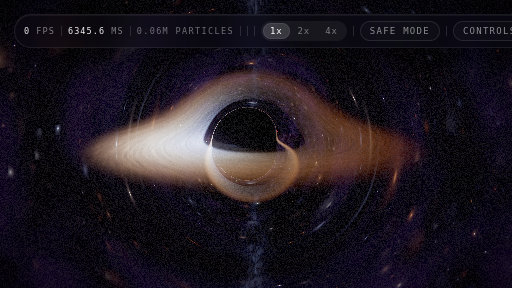

# GARGANTUA · RELATIVISTIC SINGULARITY

> A single-file, self-contained WebGL2 general-relativistic black hole.
> RK4 null-geodesic raytracing · turbulent volumetric accretion · 4,194,304
> simulated particles · 8-level Kawase bloom. **No assets. No textures. No models.**

```
           ████████████
        ████          ████            one file · 75 kB
      ██      ╭────╮      ██          three.js r160 via CDN (the only import)
     █       │ ●  │       █          zero external assets
     █       ╰────╯       █
      ██    ▁▁▁▁▁▁▁▁    ██
        ████          ████
           ████████████
```



> Captured from the headless software rasteriser at 640×360 (single-digit fps by design — on a real GPU this runs at 2× SSAA / 360 RK4 steps).

---

## Run it

```bash
npm start          # → http://localhost:8080
# or simply open index.html in any WebGL2 browser
```

Requires **WebGL2** + `EXT_color_buffer_float` (every desktop GPU since ~2016).
The runtime verifies `EXT_color_buffer_float` and `OES_texture_float_linear` on
startup and falls back to `RGBA16F` particle state if float rendering is absent.

## Controls

| Input | Action |
| --- | --- |
| drag | orbit the observer (low-inclination cinematic framing) |
| scroll | dolly 9 – 70 Rs |
| `1x / 2x / 4x` | internal SSAA (2.0× default, 4× = OVERKILL) |
| `SAFE MODE` | 1.05 M particles · 140 RK4 steps · 1× — for integrated GPUs |
| `CONTROLS` | Kerr spin · disk turbulence · Doppler intensity · camera orbit · exposure |

Deep links for benchmarking:

```
index.html?ssaa=4&steps=360
index.html?safe=1
index.html?sim=4096&steps=512     # beyond spec, if you have the VRAM
```

---

## The pipeline

```
  ┌───────────────────────────────── 1 ─────────────────────────────────┐
  │ RK4 NULL-GEODESIC RAYTRACER      full-screen fragment, HDR RGBA16F  │
  │  d²x/dλ² = −1.5·h²·x / |x|⁵       exact Schwarzschild null geodesic │
  │  ≤ 360 adaptive RK4 steps        Δλ ∝ |r−1.5 Rs| near photon sphere │
  │  volumetric disk                4-octave simplex FBM + Keplerian    │
  │                                  differential shear                 │
  │  twin polar jets                helical FBM filaments               │
  │  Doppler beaming                g = 1/(γ(1−β·n̂))·√(1−Rs/r)          │
  │  chromatic dispersion           per-channel lensed sky sampling     │
  └──────────────────────────────────┬──────────────────────────────────┘
                                     │ writes gl_FragDepth
  ┌───────────────────────────────── 2 ─────────────────────────────────┐
  │ 4,194,304-PARTICLE SIMULATION    2048×2048 RGBA32F ping-pong        │
  │  Keplerian ω ∝ r^-1.5 · frame dragging · curl FBM · jet ejection    │
  └──────────────────────────────────┬──────────────────────────────────┘
                                     │
  ┌───────────────────────────────── 3 ─────────────────────────────────┐
  │ INSTANCED MICRO-STREAKS          4.19 M quads, velocity-stretched   │
  │  depth-tested against the shadow (gl_FragDepth), Doppler-coloured   │
  └──────────────────────────────────┬──────────────────────────────────┘
                                     │
  ┌───────────────────────────────── 4 ─────────────────────────────────┐
  │ 8-LEVEL KAWASE BLOOM             soft-knee bright pass @ 1.1       │
  │  ── 5 ─ tent upsample chain ── 6 ─ anamorphic horizontal streak     │
  └──────────────────────────────────┬──────────────────────────────────┘
                                     │
  ┌───────────────────────────────── 7 ─────────────────────────────────┐
  │ ACES FILMIC COMPOSITE            lateral CA · 35 mm grain · vignette│
  │                                  absolute-void horizon lock         │
  └─────────────────────────────────────────────────────────────────────┘
```

### Physical notes

* The geodesic acceleration `−1.5·h²·x/|x|⁵` integrated with RK4 reproduces the
  exact Schwarzschild null-orbit equation `u'' + u = 3M u²` (in units `Rs = 1`),
  so the photon sphere sits at `1.5 Rs` and the shadow radius at
  `√27 M ≈ 2.598 Rs` — no fudge factors.
* The disk runs from the ISCO (`3 Rs`) to `12 Rs`. Local orbital speed uses
  `β = √(M/r)/√(1−Rs/r)`, giving the correct `0.5 c` at the ISCO.
* Observed temperature is `T_obs = T_emit · g` with
  `g = [γ(1 − β·n̂)]⁻¹ · √(1 − Rs/r)`; intensity scales as `g^2.7`.
  The result is the `7 500 – 12 000 K` electric-sapphire rim on the approaching
  side and the `1 600 – 3 200 K` molten-amber / crimson-obsidian side receding.
* Photon ring, secondary image and the Einstein ring are **not** painted — they
  fall out of the ray integration and the lensed sky lookup.

## Repo layout

```
index.html          ← the deliverable: built, self-contained (75 kB)
build.mjs           ← inlines every shader + css + module into index.html
src/
  template.html     ← page shell, HUD markup
  style.css         ← collapsed haute-couture HUD
  app.js            ← renderer, ping-pong FBOs, passes, camera, governor
  glsl/
    common.glsl     ← simplex noise, FBM, blackbody, depth mapping
    raytrace.frag   ← pass 01
    particle_sim.frag / particle_vert.vert / particle_frag.frag  ← 02 / 03
    downsample.frag / upsample.frag / anamorphic.frag / composite.frag
tools/probe.cjs     ← headless screenshot harness (dev only)
```

```bash
npm run build       # src/  →  index.html
```

## Deploy

Any static host works — it is a single HTML file.

* **GitHub Pages** — push and the bundled workflow (`.github/workflows/pages.yml`)
  publishes `index.html` automatically.
* **Netlify / Vercel / Cloudflare Pages** — drag `index.html` in. Done.
* **Anywhere** — `index.html` is fully standalone apart from the three.js CDN.

## Performance

This is a GPU *stress test* by design: at `2× SSAA` on a 1080p canvas the
raytracer alone shades ~8.3 M pixels × up to 360 steps. A performance governor
watches the frame rate for the first second and steps the internal supersampling
down if the GPU cannot sustain 20 fps; `SAFE MODE` is one click away.

MIT licensed.
